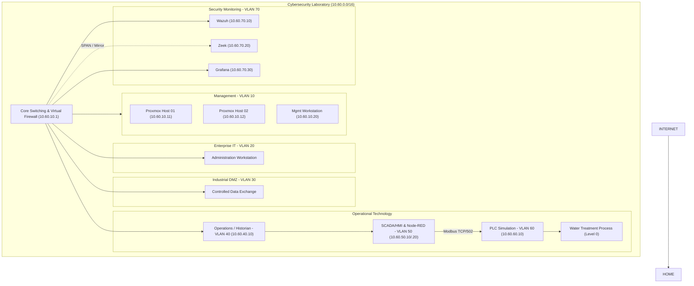

# Logical Network Architecture & IP Allocation Plan — CMWTF-01

## 1. Laboratory VLAN Segmentation (10.60.0.0/16)

Default-deny inter-VLAN routing enforced at the virtual firewall (10.60.10.1). VLANs are strictly isolated by Purdue operational and security function.

| VLAN ID | Name | Subnet | Purpose & Security Boundary |
| :--- | :--- | :--- | :--- |
| 10 | LAB-MGMT | 10.60.10.0/24 | Proxmox hypervisor & firewall management plane |
| 20 | ENTERPRISE-IT | 10.60.20.0/24 | Simulated corporate IT & workstation administration |
| 30 | OT-DMZ | 10.60.30.0/24 | Controlled data exchange & jump services |
| 40 | OT-OPS | 10.60.40.0/24 | Site operations & OT historian |
| 50 | OT-SCADA | 10.60.50.0/24 | Supervisory control, HMI & Node-RED |
| 60 | OT-CONTROL | 10.60.60.0/24 | Level 1 PLC runtime & field process simulation |
| 70 | SECURITY | 10.60.70.0/24 | SOC monitoring (Wazuh SIEM, Zeek IDS, Grafana) |
| 80 | LAB-WIRELESS | 10.60.80.0/24 | Wireless administration |
| 90 | LAB-TEST | 10.60.90.0/24 | Isolated sandbox & temporary red/purple-team testing |

---

## 2. Proposed Static IP Address Plan

| Device / Workload | Host / VM ID | VLAN | Static IP Address |
| :--- | :--- | :--- | :--- |
| Virtual Firewall | Gateway | VLAN 10 (Trunk) | 10.60.10.1 |
| Proxmox Host 01 (Industrial) | pve1 | VLAN 10 | 10.60.10.11 |
| Proxmox Host 02 (Security) | pve2 | VLAN 10 | 10.60.10.12 |
| Management Workstation | Admin Host | VLAN 10 | 10.60.10.20 |
| OT Historian | VM104 | VLAN 40 | 10.60.40.10 |
| SCADA / HMI | VM103 | VLAN 50 | 10.60.50.10 |
| Node-RED | VM102 | VLAN 50 | 10.60.50.20 |
| OpenPLC Runtime | VM101 | VLAN 60 | 10.60.60.10 |
| Wazuh Server | VM201 | VLAN 70 | 10.60.70.10 |
| Zeek Sensor | VM202 | VLAN 70 | 10.60.70.20 |
| Grafana | VM203 | VLAN 70 | 10.60.70.30 |

---

## 3. Logical Zone & Conduit Topology

